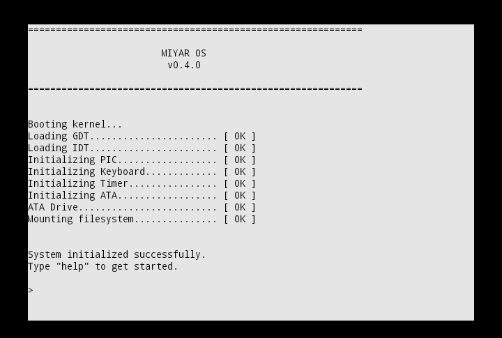

# Miyar-OS

This is an OS started by a teen who idolize Linus Torvalds, creator of Linux. The OS is made for 32-bit x86 machines and boots with GRUB and follows Multiboot 2 specs. It's written purely in C and assembly for now and was developed from scratch as a learning project.


## v0.4 - Process Management & Multitasking (Current Version):

This version introduces process management, multitasking, independent address spaces, kernel threads, schedulling, context switching, process termination, resources cleanup, and protected kernel resources at a basic level into the OS.


## Features

* Kernel
* Memory Management
* Process Management & Multitasking
* Storage & Filesystem
* Drivers
* Shell


## Built-In Shell Commands

| Command                 | Description                                    |
| ----------------------- | ---------------------------------------------- |
| `help`                  | Shows the list of available commands.          |
| `about`                 | Displays information about MiyarOS.            |
| `clear`                 | Clears the VGA text screen.                    |
| `uptime`                | Displays the time elapsed since boot.          |
| `pwd`                   | Prints the current working directory.          |
| `cd <dir>`              | Changes the current working directory.         |
| `ls [dir]`              | Lists the contents of a directory.             |
| `cat <file>`            | Displays the contents of a file.               |
| `touch <file>`          | Creates an empty file.                         |
| `mkdir <dir>`           | Creates a new directory.                       |
| `rm <file>`             | Deletes a file.                                |
| `rmdir <dir>`           | Deletes an empty directory.                    |
| `cp <src> <dst>`        | Copies a file.                                 |
| `mv <old> <new>`        | Renames or moves a file.                       |
| `echo <text>`           | Prints text to the terminal.                   |
| `echo <text> > <file>`  | Writes text to a file, replacing its contents. |
| `echo <text> >> <file>` | Appends text to the end of a file.             |
| `reboot`                | Reboots the machine.                           |
| `shutdown`              | Attempts to power off the machine.             |
| `exception`             | Triggers a divide-by-zero exception.           |
| `pagefault`             | Triggers a page fault.                         |


## Build Requirements

* GNU Make
* NASM
* GCC with 32-bit multilib support
* GNU Binutils (`ld`)
* GRUB (`grub-mkrescue`)
* xorriso
* QEMU (recommended)

## Build & Run Instructions

```bash
make clean
make

```

This builds the kernel and creates a bootable ISO.

## Run

```bash
make run
```

Or manually:

```bash
qemu-system-i386 \
  -display curses \
  -cdrom /tmp/miyaros.iso \
  -drive file=disk.img,format=raw \
  -boot d \
  -m 256
```

> **Note:** A tested bootable release ISO is available on the project's latest GitHub Release.


## Disk Image

MiyarOS requires a FAT32-formatted disk image for filesystem support.

Create a 64 MB disk image:

```bash
dd if=/dev/zero of=disk.img bs=1M count=64
```

Format it as FAT32:

```bash
mkfs.fat -F 32 disk.img
```

Place the `disk.img` in the project root folder.

> **Note:** The disk image is not included in the repository and must be created before using the filesystem.


### Planned Future
* User Mode & System Calls
* Virtual File System
* USB drivers
* Audio
* Networking
* Security improvements
* Graphical user interface
* User-space utilities and applications

## License

MiyarOS is released under the GNU General Public License v3.0. See the [LICENSE](LICENSE) file for details.
